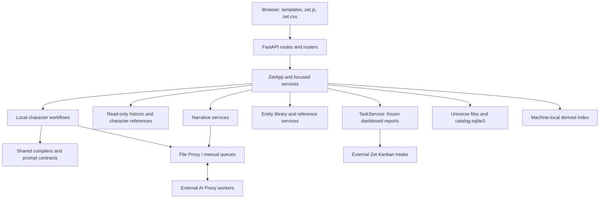

# System architecture

Head-Image Edit shares the head lifecycle through explicit identity/compiler
hooks, with separate storage, queue identity and publications. Its service policy
uses FRONT for every base view; scoped guide finishing belongs to the refinement
service. Assembly freezes its chosen head family. Web controls delegate these
decisions to services. Legacy Head-Image remains the default and existing chains
are not migrated. See [ADR 0028](DECISIONS/0028-independent-head-image-edit.md)
and [Local Characters](COMPONENTS/LOCAL_CHARACTERS.md#independent-head-image-edit-2026-10-22).

Zet combines reusable character references, scene authoring/rendering, image review, and zine assembly in a local dashboard. It is a Python application with a FastAPI UI, universe-scoped durable stores, and filesystem-based AI jobs. [README](../README.md) describes product purpose; the flows below are confirmed by code, not inferred from that overview.

## Boundaries and communication

| Boundary | Responsibility and evidence |
| --- | --- |
| [zet/web/](../zet/web/) | HTTP validation/serialization, templates, browser interaction; `create_app` owns UI lifetime. Focused routers delegate to services. |
| [zet/app.py](../zet/app.py) | `ZetApp.from_config` composition root; facade methods and `AssetRef` coordinate service calls. This is not a database model. |
| [zet/services/](../zet/services/) | Domain workflows, rendering orchestration, configuration, references, queue clients, recovery, discovery. |
| [zet/repositories/](../zet/repositories/) and [zet/models/](../zet/models/) | Persistence access and typed records. Not all persisted records are dataclasses; scenes and local run state also use normalized dictionaries. |
| [Scripts/](../Scripts/) and [zet/workers/](../zet/workers/) | Reusable prompt compilers and job scripts; worker adapters for retained pipeline records. Traditional character generation is guarded as retired. |
| [Config/](../Config/) and [Shared_Library/](../Shared_Library/) | Source-controlled prompt/configuration assets and reusable authoring templates. The user's creative library lives at configured paths. |

The required web/backend boundary is defined in [AGENTS](../AGENTS.md); it is a constraint on new changes, not a claim that every existing route is already minimal. [CODE_MAP](CODE_MAP.md) locates capabilities and tests.

Minor Characters use named workspaces independent of major character/phase pipelines. MinorCharacterService owns naming/input analysis over the wizard engine; MinorCharacterWorkflow owns stage prompts, current boards, selection/undo and rendering/review. Style selection precedes independent view alignment, then view selection precedes true-ups. Publication accepts only generated view true-ups. Web code presents service actions and comparison navigation. Fresh records replace iteration/adoption semantics without migration; private sources support reproducibility. See [ADR 0015](DECISIONS/0015-minor-character-alignment.md).

## Initialization and lifetime

1. [zet/web/app.py](../zet/web/app.py) `main` parses config/host/port and calls Uvicorn with `create_app`. There is no separate frontend build needed for normal startup; static assets are served locally.
2. [ConfigService.load](../zet/services/config_service.py) reads TOML with platform overrides. [UniverseService](../zet/services/universe_service.py) binds the selected universe's paths; `ZetApp.from_config` constructs repositories/services, initializes entity SQLite, optionally validates the record catalog, and wires publication, incremental usage and asynchronous reconciliation callbacks. Startup does not rebuild usages. **Constructing a real app can write persistent state.**
3. `create_app` caches apps by universe. Request middleware uses `x-zet-universe` or `universe_id` with a `ContextVar`, validates the selection, and lazily constructs an app for another universe under a lock. Reload replaces the universe-bound app while the common AI coordinator resolves its current instance.
4. Lifespan requests a background refresh of AI_Proxy's capability catalog, starts the shared AI collection coordinator and index reconciliation, and schedules local-character/review recovery. Proxy discovery failure retains the last-known-good shared cache. Shutdown stops generation/polling/reconciliation services. Recovery status is separately tracked; an HTTP-ready server does not prove that every recovered job or external backend is ready.

CLI modules under [zet/scripts/](../zet/scripts/) are separate operations; some use raw container config rather than `ZetApp` universe binding. Inspect the CLI before operating on a specific universe.

## Major data flows

- **Local characters:** source/template snapshots → shared compiler → proxy render candidates → Luna ranking and human review → selection → lock/publication into the entity library. Candidate workspace and approved-image lookup are separate. See [LOCAL_CHARACTERS](COMPONENTS/LOCAL_CHARACTERS.md).
- **Scene Builder (retired):** authoring/render execution is removed or fenced; historic source data remains. Dedicated geometry and integration code live in the [offline archive](../Archive/scene-builder/README.md). StoryService is now a narrow locked-character/auxiliary reference compatibility reader. Legacy image references retain read-only resolution.
- **Narrative:** dashboard-mounted story/scene/target records → prose interview/synthesis → frozen references/assembly snapshot → durable image jobs → candidate slots and selection. This subsystem does not route through Scene Builder or its pipeline state. See [NARRATIVE](COMPONENTS/NARRATIVE.md).
- **Library/discovery:** approved image bytes and entity/reference metadata are authoritative; the separate local index scans authored sources and queue summaries into published generations for dashboard queries. See [LIBRARY](COMPONENTS/LIBRARY.md).
- **Zines:** [ZineService](../zet/services/zine_service.py) uses selected Narrative final assemblies to compose print layouts; it is not the Narrative scene assembler.
- **Dashboard task capture:** browser context providers freeze a report/draft and Return to Zet location → [task router](../zet/web/task_router.py) → `ZetApp.create_task`/`upload_task_attachment` → [TaskService](../zet/services/task_service.py) → GitHub issues through server-side gh. A machine-local repository owns capture receipts and worker checkpoints; GitHub owns task state. [GitHub task workflow](GitHub_Task_Workflow.md) owns publication, quota/attention and deployment. Metadata reads do not contact GitHub. Scheduled Codex performs coding in isolated worktrees; services coordinate it without a separate execution engine.

## Persistence, integrations, and constraints

`TemplatePublicationService` owns explicit dashboard recovery of repository-template
edits: snapshots in stable runtime state and validated delivery in a separate PR
checkout. The stdlib `template_publication_core` is shared with the copied deployment
controller and master promotion for snapshot guards and the final cross-process
write fence. Routes/restart UI present services. See
[deployment recovery](GitHub_Task_Workflow.md#accepted-template-edits-and-update-recovery).

[DATA_MODEL](DATA_MODEL.md) owns storage layouts. File updates use repository transactions/atomic writes; workflow locks span threads and processes, and attempts/receipts fence stale or repeated results. Atomic replacement of one file is not a transaction across every artifact.

AI Proxy is a separate project communicating through shared queues. Ollama performs text/vision work; current production local rendering is ComfyUI with registered Qwen Image 2.1 profiles. Direct ComfyUI utility code and historical Stable Matrix adapters remain present; they do not override [production policy](../zet/services/local_render_policy.py) or AGENTS' requirement to ask before using ComfyUI directly. Creative Codex calls use the same [AI job service](../zet/services/ai_job_service.py) and File Proxy as local providers. The proxy owns a separate cloud lane; Zet owns domain result application. Live integration availability is not verified by unit fixtures.

Important complexity: a large composition facade/web module, callbacks between story/catalog/index services, retained traditional records alongside local run state, and independent scene generations. Treat these as impact-analysis concerns, not authorization for cleanup. [Decisions](DECISIONS/README.md) explain durable boundaries where evidence exists; historical motives not present in code/design notes remain unknown.

## Current test execution boundary

[Testing](Testing.md) documents the recovered local E2E harness: a disposable Test universe/private queue, temporary derived index, prepared fast responses and selected-state resets. Four maintained scenarios exercise representative authoring, character-to-costume, Narrative assembly and shared AI queue tasks. The separate live Narrative check is opt-in. Python/browser unit suites and Actions gates have been retired; these scenarios do not establish every subsystem contract. Task capture, zines, geometry and many lifecycle/error branches have no dedicated maintained scenario.

[ADR 0005](DECISIONS/0005-narrative-dashboard-and-legacy-scene-retirement.md) owns the active Narrative/legacy migration boundary. Migration CLI deliberately avoids app construction, workers and live services.

## Render slot presentation and ownership (2026-10-12)
Character adapters share [render_slot_service.py](../zet/services/render_slot_service.py) for fixed positions, supplemental candidate merging and protected mutations through the local workflow service. Image Generation's [workspace service](../zet/services/image_generation_workspace_service.py) persists universe-owned assignments over its existing jobs. Shared [render_slots.js](../zet/web/static/render_slots.js) provides presentation controls only. Active browser pages poll and patch results during review; Narrative continues owning its independent target records. No new event transport or production dependency is introduced. See [ADR 0007](DECISIONS/0007-stable-render-slots.md).

The shared request, continuation, model catalog and all-universe activity interfaces are owned by [Shared AI jobs](COMPONENTS/AI_JOBS.md).

## Unavailable storage
Storage-dependent construction is deferred when configured resources are unavailable. The waiting dashboard and standalone harvester keep probing; normal services initialize after recovery. A backend recovery service owns startup and recurring reconciliation, with local OS coordination independent of the removable volume. See [storage recovery](COMPONENTS/STORAGE_RECOVERY.md).
