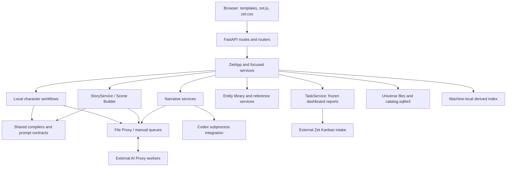

# System architecture

Zet combines reusable character references, scene authoring/rendering, image review, and zine assembly in a local dashboard. It is a Python application with a FastAPI UI, universe-scoped durable stores, and filesystem-based AI jobs. [README](../README.md) describes product purpose; the flows below are confirmed by code, not inferred from that overview.

## Boundaries and communication

| Boundary | Responsibility and evidence |
| --- | --- |
| [zet/web/](../zet/web/) | HTTP validation/serialization, templates, browser interaction; `create_app` owns UI lifetime. Focused routers delegate to services. |
| [zet/app.py](../zet/app.py) | `ZetApp.from_config` composition root; facade methods and `AssetRef` coordinate service calls. This is not a database model. |
| [zet/services/](../zet/services/) | Domain workflows, rendering orchestration, configuration, references, queue clients, recovery, discovery. |
| [zet/repositories/](../zet/repositories/) and [zet/models/](../zet/models/) | Persistence access and typed records. Not all persisted records are dataclasses; scenes and local run state also use normalized dictionaries. |
| [Scripts/](../Scripts/) and [zet/workers/](../zet/workers/) | Reusable prompt compilers and job scripts; worker adapters for retained pipeline records. Traditional character generation is guarded as retired. |
| [Config/](../Config/) and [Shared_Library/](../Shared_Library/) | Source-controlled prompt/configuration assets and reusable authoring templates. The user's creative library lives at configured paths. |

The required web/backend boundary is defined in [AGENTS](../AGENTS.md); it is a constraint on new changes, not a claim that every existing route is already minimal. [CODE_MAP](CODE_MAP.md) locates capabilities and tests.

## Initialization and lifetime

1. [zet/web/app.py](../zet/web/app.py) `main` parses config/host/port and calls Uvicorn with `create_app`. There is no separate frontend build needed for normal startup; static assets are served locally.
2. [ConfigService.load](../zet/services/config_service.py) reads TOML with platform overrides. [UniverseService](../zet/services/universe_service.py) binds the selected universe's paths; `ZetApp.from_config` constructs repositories/services, initializes entity SQLite, optionally validates the record catalog, refreshes usages, and wires write/reconciliation callbacks. **Constructing a real app can write persistent state.**
3. `create_app` caches apps by universe. Request middleware uses `x-zet-universe` or `universe_id` with a `ContextVar`, validates the selection, and lazily constructs an app for another universe under a lock. Reload stops the previous app's Narrative poller and index reconciler before replacement.
4. Lifespan refreshes Ollama's model catalog on a daemon thread, starts ad hoc image generation, Narrative job polling, and index reconciliation, and schedules local-character/review recovery. Ollama refresh failure retains the saved catalog. Shutdown stops generation/polling/reconciliation services. Recovery status is separately tracked; an HTTP-ready server does not prove that every recovered job or external backend is ready.

CLI modules under [zet/scripts/](../zet/scripts/) are separate operations; some use raw container config rather than `ZetApp` universe binding. Inspect the CLI before operating on a specific universe.

## Major data flows

- **Local characters:** source/template snapshots → shared compiler → proxy render candidates → defect gates/ranking → human selection → lock/publication into the entity library. Candidate workspace and approved-image lookup are separate. See [LOCAL_CHARACTERS](COMPONENTS/LOCAL_CHARACTERS.md).
- **Scene Builder (retiring):** story Markdown/settings + Scene Builder V4 JSON + resolved references/layout → render target IR (intermediate representation) → general/local/Qwen prompt artifacts → immutable queue task → candidate review → locked target image. Targets may depend on accepted subscene renders. Still usable, but current scene/story testing targets Narrative; no maintained Scene Builder/local scene-batch scenario remains. See [SCENE_BUILDER](COMPONENTS/SCENE_BUILDER.md).
- **Narrative:** independent story/scene/target records → prose interview/synthesis → frozen references/assembly snapshot → durable image jobs → candidate slots and selection. This subsystem does not route through Scene Builder or its pipeline state. See [NARRATIVE](COMPONENTS/NARRATIVE.md).
- **Library/discovery:** approved image bytes and entity/reference metadata are authoritative; the separate local index scans authored sources and queue summaries into published generations for dashboard queries. See [LIBRARY](COMPONENTS/LIBRARY.md).
- **Zines:** [ZineService](../zet/services/zine_service.py) uses finished story-scene sources to compose print layouts; it is not the Narrative scene assembler.
- **Dashboard task capture:** browser context providers freeze a report/draft and Return to Zet location → [task router](../zet/web/task_router.py) → `ZetApp.create_task`/`upload_task_attachment` → [TaskService](../zet/services/task_service.py) → external Kanban intake. Zet owns forwarding/context, while Kanban owns board files and request-ID idempotency. [Kanban integration](Kanban_Integration.md) owns the detailed contract; metadata reads make no Kanban request.

## Persistence, integrations, and constraints

[DATA_MODEL](DATA_MODEL.md) owns storage layouts. File updates use repository transactions/atomic writes; workflow locks span threads and processes, and attempts/receipts fence stale or repeated results. Atomic replacement of one file is not a transaction across every artifact.

AI Proxy is a separate project communicating through shared queues. Ollama performs text/vision work; current production local rendering is ComfyUI with registered Qwen Image 2.1 profiles. Direct ComfyUI utility code and historical Stable Matrix adapters remain present; they do not override [production policy](../zet/services/local_render_policy.py) or AGENTS' requirement to ask before using ComfyUI directly. Narrative additionally has a [Codex integration](../zet/services/narrative_codex_service.py). Live integration availability is not verified by unit fixtures.

Important complexity: a large composition facade/web module, callbacks between story/catalog/index services, retained traditional records alongside local run state, and independent scene generations. Treat these as impact-analysis concerns, not authorization for cleanup. [Decisions](DECISIONS/README.md) explain durable boundaries where evidence exists; historical motives not present in code/design notes remain unknown.

## Current test execution boundary

[Testing](Testing.md) documents the recovered local E2E harness: a disposable Test universe/private queue, temporary derived index, prepared fast responses and selected-state resets. Exactly three maintained scenarios exercise representative authoring, character-to-costume and Narrative assembly tasks. The separate live Narrative check is opt-in. Python/browser unit suites and Actions gates have been retired; these scenarios do not establish every subsystem contract. Task capture, zines, geometry and many lifecycle/error branches have no dedicated maintained scenario.
